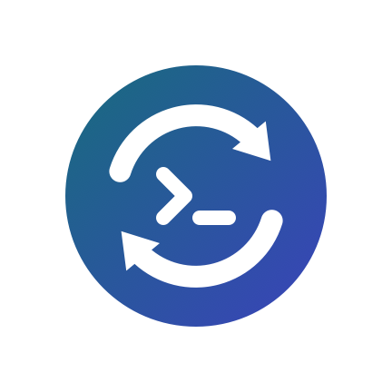
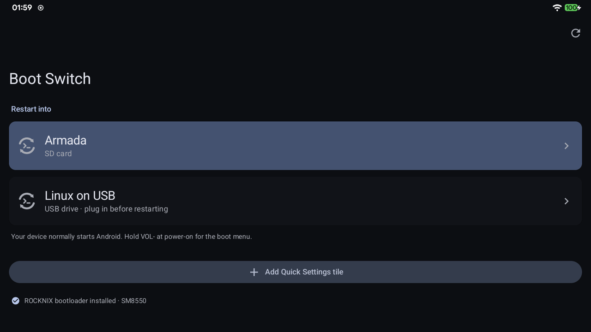
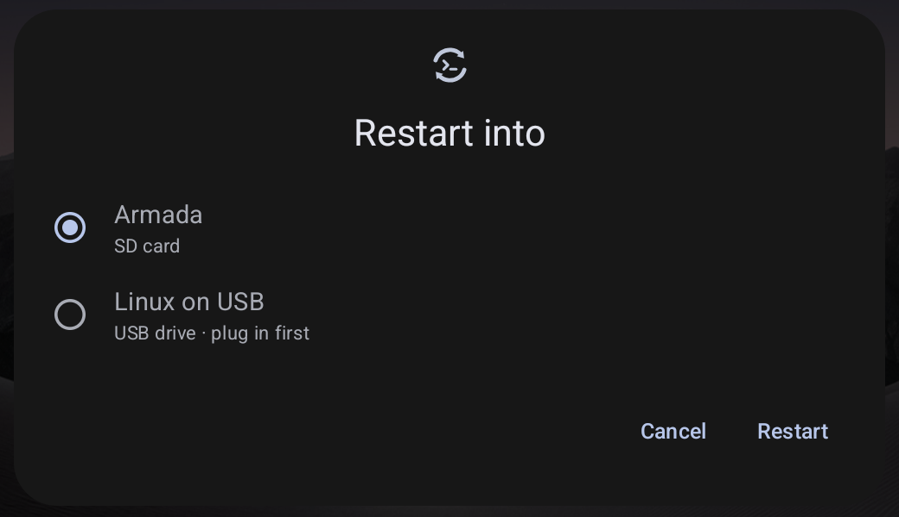
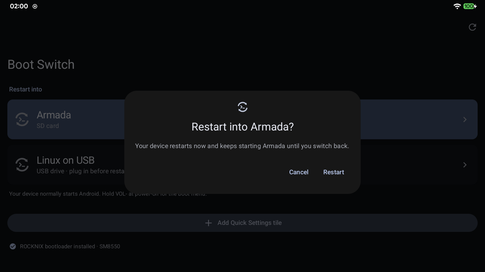
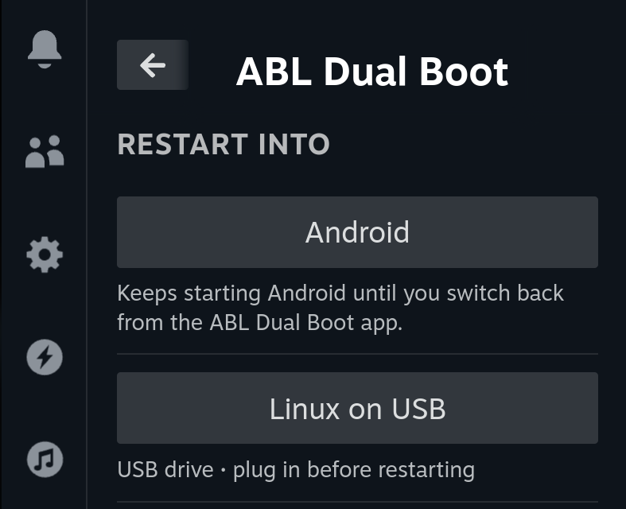

<p align="center"></p>

# ABL Dual Boot

One-tap switching between **Android** and **Linux** on handhelds that use the
[ROCKNIX ABL](https://github.com/ROCKNIX/abl) or a supported
[OpenABL](https://github.com/OpenHandheldCollective/OpenABL) bootloader. No more holding VOL- at power-on.

Works with any Linux that boots through the ROCKNIX ABL (Armada, ROCKNIX, Batocera, Knulli, …),
from an **SD card or internal storage**, and with every common root solution: **Magisk, KernelSU,
KernelSU Next, SukiSU, APatch**.

**OpenABL switching is experimental and has not been tested on a device.** It requires a build after
v1.2 that stores settings in `misc` (main since
[`71c0040`](https://github.com/OpenHandheldCollective/OpenABL/commit/71c0040)), booted at least once
to initialize its settings store. Released OpenABL **v1.0–v1.2 are not supported**: they use UEFI variables.
Switching is refused if either slot matches one of those releases, or the existing `misc` store is not
valid version 1. ABL Dual Boot never creates or repairs this store. These rules apply to the Android app
and tile, Linux launcher and Decky plugin. ROCKNIX installation and restoration remain blocked whenever
OpenABL is present; Armada replaces ROCKNIX ABL with OpenABL at shutdown.

<a href="../../releases/latest/download/ABL-Dual-Boot.apk"></a>

## Screenshots

| Android app | Quick Settings tile |
|---|---|
|  |  |
| **Confirm** | **Linux (Steam Game Mode, Decky)** |
|  |  |

## Quick start

**1. Android:** install [`ABL-Dual-Boot.apk`](../../releases/latest/download/ABL-Dual-Boot.apk) and open it.
- Allow root when asked (KernelSU / APatch: enable *ABL Dual Boot* in the manager's *Superuser* tab).
- No ROCKNIX ABL yet? Tap **Install ROCKNIX ABL**. Your stock bootloader is backed up first.
- Tap **Add Quick Settings tile**.

**2. Linux:** run once in a terminal (or over SSH):
```sh
curl -fsSL https://github.com/kingsleydon/abl-dualboot/releases/latest/download/install-linux.sh | sudo bash
```

**3. Switch:** pick where to go. ABL Dual Boot finds every Linux system the ROCKNIX ABL can start (internal storage,
SD card, USB) and shows it by name, e.g. **Armada**, **ROCKNIX**, **Batocera**.

| From | Tap |
|---|---|
| Android | Quick Settings tile, or the app → **Restart into** → *Armada · SD card* |
| Linux (Game Mode) | **…** → **ABL Dual Boot** → **Android**, or another Linux system |
| Linux (desktop) | App menu → **Reboot to Android** |

**After an Android system update** the update puts back the stock bootloader and the Linux boot menu
disappears. ABL Dual Boot shows a notification. Tap it, then **Restore**.

## Tested devices

| Device | Chip | Android | Linux | Result |
|---|---|---|---|---|
| AYN Odin 2 Portal | SM8550 | LineageOS 23.2 + KernelSU | Armada 20260926 (SD card) | ✅ Switching both ways |

Tried it on another device? A [device report](../../issues/new?template=device.yml) adds it here.

## Updates

Every part updates the way its platform intends:

| Part | How it updates |
|---|---|
| Android app | Built-in: checks this repo's releases daily and updates through Android's `PackageInstaller`. After you allow *Install unknown apps* once, updates install without prompts (or turn on *Install updates automatically*). You can also track it with [Obtainium](https://github.com/ImranR98/Obtainium). |
| Decky plugin | Re-run the Linux installer for now; Decky's Plugin Store will handle it once the plugin is listed. |
| ROCKNIX ABL version | The app downloads a pinned release on demand; a weekly workflow opens a PR to update the pin when ROCKNIX releases a new ABL, for review and testing. |

Downloads are checked against the SHA-256 digest GitHub publishes for each release file, releases are immutable,
and Android only accepts an update signed with the same key.

## Other downloads

| File | For |
|---|---|
| `abl-dualboot-decky.zip` | Decky plugin only (the installer already adds it) |
| `abl-dualboot-linux.zip` | `dualboot.py`, desktop launcher and bootloader catalog, for manual installs |

> [!WARNING]
> ABL Dual Boot writes to the `devinfo` partition (which also stores bootloader state), or the last 4 KiB of
> `misc` on supported OpenABL builds, and installing the
> ROCKNIX ABL replaces your bootloader. It is tested only on an **AYN Odin 2 Portal (SM8550)** with ROCKNIX ABL v1.2,
> LineageOS 23.2 and Armada. Every tool refuses to write unless the layout matches exactly, verifies every write and
> restores the original on mismatch. The VOL- boot menu always remains as a fallback. Use at your own risk.

## How it works

The ROCKNIX ABL keeps its settings as named entries in `devinfo`. The values below come from the ABL v1.2
binary (LinuxLoader), whose menu code was disassembled to confirm them:

| Setting | Offset | Values |
|---|---|---|
| `BootMode` | `0xA92` | `0` Linux · `1` Android |
| `BootSourceMode` | `0xAF0` | `0` Internal · `1` Auto · `2` USB · `3` SDcard |

ABL Dual Boot does exactly what the menu's **Switch boot mode** does:

- **Linux → Android:** `BootMode=1`, `BootSourceMode` reset to `0`.
- **Android → Linux:** `BootMode=0`. If `BootSourceMode` is `0` and no Linux is installed internally, `BootSourceMode=3` (SD card).
  "Installed internally" means partitions follow `userdata` on the same disk, which is how Armada/ROCKNIX install to internal storage.

Supported OpenABL builds keep a CRC-32 protected settings store in the last 4096 bytes of `misc`.
`BootMode` is `0` Linux / `1` Android; `BootSource` is `0` Auto / `1` Internal / `2` SD / `3` USB.
Switching to Android sets Internal. Switching to Linux keeps the source, except Internal falls back to
SD when Linux is not installed internally; an explicit location overrides it. Missing or invalid setting
values use OpenABL's defaults (Linux and Auto). Other records are preserved, the `DeviceModel` header copy
is refreshed, and the CRC is resealed. Linux uses Python's `zlib`; Android uses Kotlin's `java.util.zip.CRC32`
with a root shell for bounded I/O. Both back up the store, sync and verify the full edited store and unchanged
partition prefix, and restore the original store if verification fails. No bytes before the store are written.

ABL Dual Boot lists each place that has Linux (one per location, which is what the ABL supports):
internal storage when partitions follow `userdata`, the SD card when one is inserted, and USB (which can only be
detected at boot). The name comes from the first partition's label (`ARMADA`, `ROCKNIX`, `BATOCERA`, ...).
On the command line: `dualboot.py targets`, then `dualboot.py linux sd|internal|usb`. ROCKNIX ABL builds are recognised by
their `qtestsign` signing certificate (the stock ABL is Qualcomm-signed). OpenABL also uses that certificate,
so its release prefix SHA-256 hashes are checked first. The shared catalog includes all published
OpenABL v1.0–v1.2 images and the historical hashes from
[OpenABL-Android-Installer](https://github.com/OpenHandheldCollective/OpenABL-Android-Installer/tree/c9f9dbc).
Python and the Android app also check the `OpenABL\0<version>\0` marker inside the LZMA firmware volume,
with bounded input, memory and output. Android uses XZ for Java; the shell helpers use the hash catalog
without decompressing firmware. Custom builds are therefore detected by the app and Python marker
check, while standalone shell helpers recognise cataloged release images only. Linux also refuses when
the running firmware's `LoaderInfo` or OpenABL `SettingsSchema` EFI variable identifies OpenABL.

## Build

- `android/`: Kotlin + Jetpack Compose (Material 3), root via [libsu](https://github.com/topjohnwu/libsu). `./gradlew assembleRelease`
- `decky/`: built from [decky-plugin-template](https://github.com/SteamDeckHomebrew/decky-plugin-template). `pnpm i && pnpm build`
- `shared/`: the device scripts the app runs as root

Run `python3 -m unittest discover -s tests -v` for Python and shell checks, and
`cd android && ./gradlew :app:testDebugUnitTest :app:lintDebug :app:assembleRelease` for Android.
The Android and Python tests share small synthetic firmware and settings-store fixtures; no device partitions
are touched. `MISC`, `DEVINFO` and `ABL_BY_NAME` override partition paths for fixture testing (Linux also
accepts `EFIVARS`); do not point test runs at real partitions.

GitHub Actions builds everything; pushing a `v*` tag publishes a release. The ROCKNIX ABL is downloaded only when you install or restore the bootloader, from the official release, and
checked against the SHA-256 pinned in `abl.properties`.

## Verify a download

Every release file has a signed build attestation from GitHub Actions:

```sh
gh attestation verify ABL-Dual-Boot.apk -R kingsleydon/abl-dualboot
```

## Contributing

Device reports are the most useful contribution. See [CONTRIBUTING.md](CONTRIBUTING.md).

## License

MIT. ROCKNIX ABL is © the ROCKNIX team under its own terms. The Decky plugin is based on decky-plugin-template (BSD-3-Clause).
